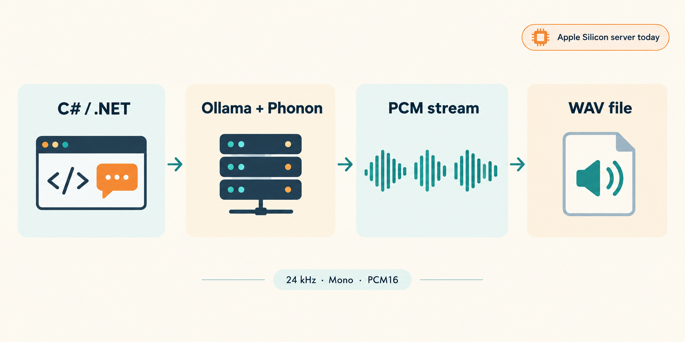
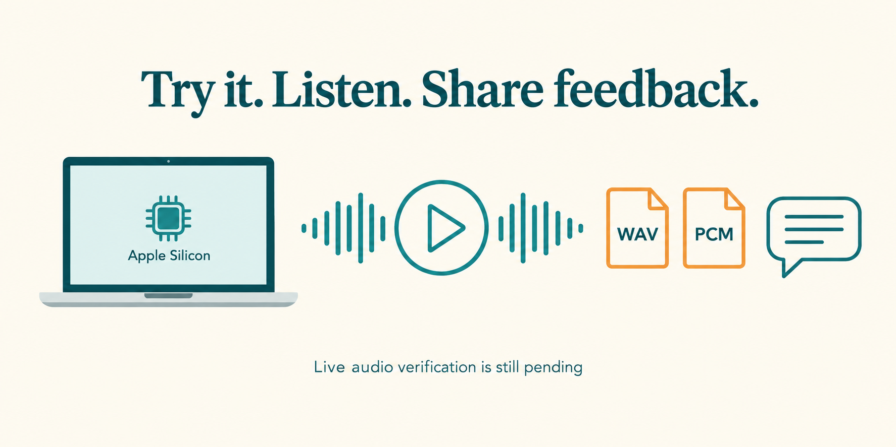

# C# + Ollama: Give Your App a Voice with Phonon

Apple Silicon users, please try this C# sample and let us know whether speech generation and playback work on your Mac!

**ElBruno.Speech 1.6.0-preview.5** keeps setup simple: call `services.AddOllamaSpeech()` for `Microsoft.Extensions.AI.ITextToSpeechClient`. It defaults to local Ollama and the `phonon` model. Let's turn a sentence into a WAV file, with local inference handled by Ollama.



*Conceptual flow, not a recording of generated audio. Image generated with AI.*

## 1. Get ready

Use .NET 8 or 10 and a supported **Apple Silicon Mac running Ollama with MLX**. Ollama's speech announcement recommends version 0.40.11 or later.

```sh
ollama pull phonon
dotnet new console -n HelloPhonon -f net10.0
cd HelloPhonon
dotnet add package ElBruno.Speech.Tts.Ollama --version 1.6.0-preview.5
dotnet add package ElBruno.Speech.Audio --version 1.6.0-preview.5
dotnet add package Microsoft.Extensions.DependencyInjection --version 10.0.13
```

For .NET 8, replace `net10.0` with `net8.0`. Make sure Ollama is running.

**Windows friends:** the C# client can call a supported remote Mac, but local Ollama speech currently requires MLX. Windows/Linux server support is pending upstream, with no promised date.

## 2. Replace Program.cs

The MEAI speech API is experimental. The pragma below explicitly opts into it for this preview.

```csharp
#pragma warning disable MEAI001

using ElBruno.Speech;
using ElBruno.Speech.Audio;
using ElBruno.Speech.Tts.Ollama;
using Microsoft.Extensions.AI;
using Microsoft.Extensions.DependencyInjection;

var services = new ServiceCollection();
services.AddOllamaSpeech();

using var provider = services.BuildServiceProvider();
var speech = provider.GetRequiredService<ITextToSpeechClient>();
using var pcm = new MemoryStream();

await foreach (var update in speech.GetStreamingAudioAsync(
    "Hello from C sharp! My app has a voice thanks to Ollama Phonon.",
    new TextToSpeechOptions { AudioFormat = "pcm" }))
{
    foreach (var audio in update.Contents.OfType<DataContent>())
        await pcm.WriteAsync(audio.Data);
}

byte[] samples = pcm.ToArray();
if (samples.Length == 0 || samples.Length % 2 != 0)
    throw new InvalidDataException("Expected complete PCM16 audio samples.");

WavWriter.Write("hello.wav",
    new AudioFormat(24000, 1, AudioSampleFormat.Int16), samples);

Console.WriteLine($"Saved: {Path.GetFullPath("hello.wav")}");
```

Run it:

```sh
dotnet run
```

On a supported Mac, listen with:

```sh
afplay hello.wav
```

The client receives PCM chunks incrementally. This short example buffers them, then writes a WAV with the final sizes: **24 kHz, mono, signed 16-bit PCM**. It does not play audio while streaming.

No configuration is required for local Ollama: the defaults are `http://localhost:11434/`, model `phonon`, the model's default voice, and WAV output. This example requests PCM per call for streaming. Using a remote Mac? Replace the registration with `services.AddOllamaSpeech(new OllamaSpeechOptions { Endpoint = new Uri("http://YOUR-MAC:11434/") });`. The library resolves the speech route automatically. Keep that server on a trusted network; this example does not configure authentication or expose it.

## 3. Try the complete demo

The [full C# sample](https://github.com/elbruno/ElBruno.Speech/tree/v1.6.0-preview.5/src/samples/OllamaSpeechDemo) also saves complete WAV and streamed PCM/WAV files, validates their format, rejects silent output, and supports optional playback.

**Honest status:** 49 synthetic provider/sample test cases pass on each of .NET 8 and .NET 10, including no-options registration, default request values, and URL normalization for complete and streaming requests. My Windows host could not load Phonon because MLX was unavailable, so I have **not generated or listened to real Phonon speech yet**. Automated checks are not proof of pronunciation or sound quality.



*Community testing invitation, not proof of working audio. Image generated with AI.*

If you test it, share your Mac chip, macOS and Ollama versions, whether `hello.wav` plays, and how it sounds in [issue #106](https://github.com/elbruno/ElBruno.Speech/issues/106). Please include any error message, but no secrets or private audio.

[NuGet package](https://www.nuget.org/packages/ElBruno.Speech.Tts.Ollama/1.6.0-preview.5) | [Release notes](https://github.com/elbruno/ElBruno.Speech/releases/tag/v1.6.0-preview.5) | [Ollama speech docs](https://docs.ollama.com/capabilities/speech)

Happy coding!

---

**Suggested tags:** C#, .NET, Ollama, Phonon, Text-to-Speech, Microsoft.Extensions.AI, Local AI, Apple Silicon, ElBruno.Speech

**Suggested slug:** `csharp-ollama-phonon-text-to-speech`

**Image publishing notes:** Use `ollama-speech-flow.png` as the featured image and first inline diagram. Place `apple-silicon-test.png` in the community-testing section. Both Markdown image descriptions above are the suggested WordPress alt texts. Upload the PNG files to the Media Library and replace the relative image paths with their uploaded URLs.
